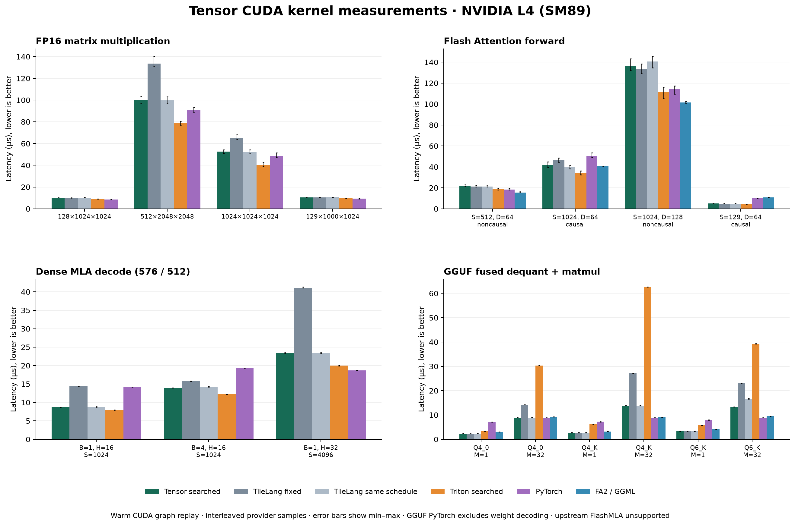

<p align="center">
  <picture>
    <source media="(prefers-color-scheme: dark)" srcset="logo/tensor-wordmark-on-dark.svg">
    
  </picture>
</p>

<h1 align="center">Portable kernels. Small runtime.</h1>

<p align="center">
  Build TileLang kernels into portable artifacts.<br>
  Execute them with a small runtime and your hardware driver.
</p>

<p align="center">
  <a href="docs/quickstart.md"><strong>Quickstart</strong></a> &nbsp;·&nbsp;
  <a href="docs/README.md">Documentation</a> &nbsp;·&nbsp;
  <a href="research/studies/cuda-showcase/README.md">Benchmarks</a> &nbsp;·&nbsp;
  <a href="CONTRIBUTING.md">Contributing</a>
</p>

<p align="center">
  <code>TileLang kernel</code> → <code>Tensor compiler</code> → <code>.tbin</code> → <code>Tensor runtime</code> → <code>device</code>
</p>

---

Compilation and execution are separate: consumers need the runtime and their
hardware driver, without TileLang, TVM, or PyTorch. CUDA, WebGPU, and a scoped CPU
provider share buffer and executable contracts. Tensor is pre-1.0 (`0.1.0`);
see [compatibility](docs/compatibility.md) before transferring artifacts.

## CUDA benchmark showcase

Measured on **NVIDIA L4 (SM89), 24 October 2026**. All **17 cases** passed
final numerical checks, with 260 Tensor and 142 Triton schedule candidates measured.



| Workload | Tensor speedup over fixed TileLang | Result |
|---|---:|---|
| FP16 matmul | 0.99–1.34× | Larger shapes benefit from search; tuned Triton and PyTorch CUDA BLAS remain faster. |
| Flash Attention | 0.97–1.12× | Causal S=129 beats upstream FA2 by 2.20×; larger cases favor FA2 or Triton. |
| Dense MLA decode | 1.13–1.76× | Search improves split geometry; Triton remains 10–17% faster than Tensor. |
| GGUF prefill | 1.59–1.96× | Reused AKAS fused kernels beat measured Triton implementations; GGML wins Q4_K/Q6_K. |
| GGUF single-row decode | About parity | Existing AKAS GEMV is already strong; Tensor beats GGML by 1.18–1.31×. |

These are resident kernel timings using CUDA graphs, excluding compilation,
tuning, allocation, transfers and host submission. Gains primarily reflect
schedule selection; they do not establish a general advantage over equally
scheduled native TileLang or measure full-model or serving performance.

See the [full benchmark study](research/studies/cuda-showcase/README.md) for
per-case timings, matched controls, raw evidence, limitations and reproduction.

## Install the CLI

Linux/macOS:

```sh
curl -fsSL https://raw.githubusercontent.com/kreasof-ai/tensor/main/tools/install/install.sh | bash
```

Windows:

```powershell
powershell -ExecutionPolicy Bypass -c "irm https://raw.githubusercontent.com/kreasof-ai/tensor/main/tools/install/install.ps1 | iex"
```

Open a new terminal and run `tensor --help`. The installer manages Python 3.12
and installs the runtime under `~/.tensor`, without a system Python or Git.
[Installation](docs/installation.md) covers optional compiler/WebGPU dependencies,
custom paths, updates, removal, and installing Tensor into a Python project.

## First kernel

Use 64-bit Python 3.12 and [uv](https://docs.astral.sh/uv/):

```sh
git clone https://github.com/kreasof-ai/tensor.git
cd tensor
uv sync --locked
uv run --locked python tools/bootstrap/bootstrap_nvrtc.py --out build/nvrtc-12.9
export TENSOR_NVRTC_HOME="$PWD/build/nvrtc-12.9"
uv run --locked tensor build examples/elementwise.py --out build/elementwise.tbin
uv run --locked python examples/run_elementwise.py build/elementwise.tbin
```

The example checks `relu(2 * a + b)` against NumPy. The
[quickstart](docs/quickstart.md) includes PowerShell, explicit GPU targets, and a
separate compiler-free consumer. To explore the CLI without a compiler or GPU:

```sh
uv sync --locked --no-default-groups
uv run --locked --no-default-groups tensor --help
```

## Read and extend

| Task | Start here |
|---|---|
| Build and execute a kernel | [Quickstart](docs/quickstart.md) |
| Understand the implementation | [Architecture](docs/architecture.md) |
| Import TileLang kernels or search schedules | [Compilation](docs/compilation.md) |
| Allocate buffers, launch kernels, use streams or manual backward | [Runtime](docs/runtime.md) |
| Package named exports and distribute artifacts | [Modules](docs/modules.md) |
| Use WebGPU | [Backends](docs/backends.md) |
| Bind kernels to PyTorch | [Tensor Torch](packages/tensor-torch/README.md) |
| Compose native NN modules and train nanoGPT | [Tensor NN](packages/tensor-nn/README.md) |
| Develop and validate Tensor | [Development](docs/development.md) |

[AKAS](https://github.com/kreasof-ai/akas) owns model inference, generation,
scheduling, and serving. [Loop Latent Transformer](https://github.com/kreasof-ai/loop-latent-transformer)
owns LLT workloads. Tensor supplies their compilation and execution primitives.

The distribution is named `tensor-workspace`; Python imports and the CLI use
`tensor`. Optional bindings/templates have separate distributions. See the
[documentation index](docs/README.md), [changelog](CHANGELOG.md), and
[contribution guide](CONTRIBUTING.md). Historical measurements and design decisions
are retained under [research](research/README.md), separate from current usage.

MIT licensed. Compiler dependencies retain their own licenses.
