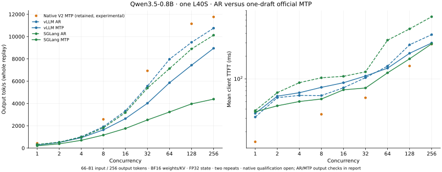

# Qwen3.5-0.8B local scaling exercise

This is an experimental implementation checkpoint on one NVIDIA L40S, not a
completed speedup claim. The best measured native profile reaches 426 output
tok/s at C1 and 11,763 at C256. The requested 1.5× low-concurrency and 2×
middle/high-concurrency advantages over both vLLM and SGLang remain unmet.

The model is `Qwen/Qwen3.5-0.8B`, revision
`2fc06364715b967f1860aea9cf38778875588b17`. These measurements use BF16
weights, BF16 KV and FP32 recurrent state, with no CPU offload or prefix cache.
Native MTP uses the checkpoint's official head with a two-position verifier.
The October 11 follow-up measures both AR and official MTP on vLLM and SGLang.
Each MTP baseline drafts one token and verifies two positions, matching the
retained native profile. This is a fixed-depth comparison, not a search for each
baseline's best speculative depth. Native results remain the October 10 V2
measurements; the latest native source was not remeasured for this follow-up.

| Concurrency | Native V2 MTP tok/s | vLLM AR tok/s | vLLM MTP tok/s | SGLang AR tok/s | SGLang MTP tok/s |
|---|---:|---:|---:|---:|---:|
| 1 | 426.3 | 314.1 | 272.9 | 322.6 | 202.7 |
| 2 | pending | 523.8 | 501.6 | 517.2 | 377.6 |
| 4 | pending | 1,016.5 | 927.9 | 979.9 | 697.6 |
| 8 | 2,579.2 | 1,915.8 | 1,631.4 | 1,810.9 | 1,164.6 |
| 16 | pending | 3,328.2 | 2,641.2 | 3,177.0 | 1,756.3 |
| 32 | 6,929.0 | 5,558.4 | 4,021.0 | 5,380.7 | 2,524.8 |
| 64 | pending | 7,971.2 | 5,860.6 | 7,129.1 | 3,236.8 |
| 128 | 11,147.5 | 9,485.0 | 7,434.9 | 8,894.8 | 3,964.9 |
| 256 | 11,762.7 | 10,753.8 | 8,947.7 | 10,125.7 | 4,388.7 |

Values are arithmetic means of two complete HTTP replays. All displayed runs
completed with zero request failures. Throughput includes prefill, admission,
streaming and drain; it is not a selected decode interval. TTFT is measured at
the client. Individual repeat rates and client streams are retained.

The workload uses varied natural-language prompts of 66–81 tokens and exactly
256 greedy output tokens, ignoring EOS. Each point has `max(16, 4*C)` requests,
closed-loop refill, and two separate warmup requests before each repeat. Context
capacity is 4,096. These are **not 32K-input/16K-output measurements**. Separate
long-context tests through C64 are still pending. Train, held-out and unequal
output-length drain workloads are preserved, but the displayed throughput
comes from the train workload. Held-out throughput qualification is pending.

The baseline versions remain vLLM 0.17.1 and SGLang 0.5.9. The new AR and MTP
controls all use streaming interval four. Before measurement, each baseline
receives one untimed wave of C requests generating 64 tokens at each of the nine
concurrency values. The existing two serial warmup requests still run before
each repeat. These additional concurrency warmups and their request records are
retained. The first vLLM MTP pass, before this additional warmup, is preserved
separately and excluded from the displayed means. Engines are tested sequentially;
producer compilation and kernel searches are stopped during timed replays.
Native streaming publishes the first token immediately and subsequent groups at
approximately four tokens.

vLLM enables MTP with
`--speculative-config '{"method":"mtp","num_speculative_tokens":1}'`, following
the [official Qwen recipe](https://recipes.vllm.ai/Qwen/Qwen3.5-9B).
It retains `--max-num-seqs 256`, `--max-model-len 4096`, an 8,192-token prefill
budget, disabled prefix caching and GPU memory utilization 0.85 for both AR and
MTP. Its startup confirms that the checkpoint's MTP model shares the target
embedding and language-model head.

SGLang uses the [official Qwen3.5 MTP flags](https://github.com/sgl-project/sglang/blob/main/docs_new/cookbook/autoregressive/Qwen/Qwen3.5.mdx),
with `--speculative-algorithm EAGLE --speculative-num-steps 1
--speculative-eagle-topk 1 --speculative-num-draft-tokens 2`, and the same pinned
checkpoint as its draft model. The measured profile sets
`SGLANG_ENABLE_SPEC_V2=False`: the newer overlap speculative path fails during
startup in this installed version, at the Qwen MTP `input_embeds` assertion.
The compatible older MTP path disables overlap scheduling; the AR control uses
its normal overlap scheduler.

SGLang retains a 4,096-token context, `--max-running-requests 256`, CUDA graphs
through batch 256, an 8,192-token prefill chunk and disabled radix cache. Both
new SGLang controls use `--mem-fraction-static 0.50`. With 0.70, the older MTP
path passes warmup through C128 but runs out of memory during C256's recurrent
state commit: it requests another 4.50 GiB with 1.76 GiB free. The smaller cache
reservation permits the complete short-context C256 load. Failed configurations
and logs are preserved; no CPU offload or reduced concurrency is used.

## MTP comparison and TTFT

One-draft MTP is slower than AR at every measured concurrency for both tested
baseline configurations. At C1, vLLM MTP achieves 0.869× its AR rate and SGLang
achieves 0.628×. At C256, these ratios are 0.832× and 0.433×. MTP remains a
configuration choice rather than the default winner for this workload. The
retained native C256 result is 1.094× the faster baseline (vLLM AR), so the 2×
high-concurrency target remains unmet. These timings do not establish a model
quality advantage.

Client TTFT below is the mean of the two repeat means, in milliseconds.

| Concurrency | Native V2 MTP | vLLM AR | vLLM MTP | SGLang AR | SGLang MTP |
|---|---:|---:|---:|---:|---:|
| 1 | 14.7 | 31.3 | 35.0 | 38.1 | 36.8 |
| 2 | pending | 56.4 | 59.1 | 65.8 | 44.1 |
| 4 | pending | 60.4 | 65.6 | 89.1 | 50.2 |
| 8 | 34.0 | 60.2 | 77.3 | 103.4 | 54.2 |
| 16 | pending | 76.2 | 88.9 | 108.1 | 71.7 |
| 32 | 56.3 | 103.8 | 109.2 | 123.9 | 75.8 |
| 64 | pending | 147.4 | 138.5 | 324.9 | 120.2 |
| 128 | 148.1 | 282.3 | 218.0 | 458.0 | 184.2 |
| 256 | 287.7 | 384.4 | 298.1 | 662.9 | 290.3 |

SGLang MTP lowers mean C256 TTFT from 663 ms to 290 ms despite reducing whole
replay output throughput. TTFT and sustained output rate should be assessed
separately. Full repeat distributions are retained in the reports.

The [serial output comparison](data/qwen35-08b-local-scaling/mtp-serial-quality.json)
uses the same eight prompts and 32 greedy output tokens per prompt for each
engine's AR and MTP modes. vLLM matches all token IDs on 5/8 prompts (177/256
position-wise ID matches); SGLang matches on 6/8 (242/256). vLLM's first
divergences occur at zero-based output positions 1, 3 and 4; SGLang's at 19
and 18. An early greedy divergence can change subsequent conditioning, so
position-wise matches are not a model accuracy score. No cause is assumed,
and exact serial AR/MTP output equivalence is not established by these runs.
The original responses, generated IDs and log probabilities where available
are preserved. Broader quality qualification remains separate.

The [comparison summary](data/qwen35-08b-local-scaling/mtp-comparison.json) is
generated by `python -m benchmarks.qwen35.dense_comparison`. It validates
workload hashes, precision settings, repeat completeness and raw client stream
counts before computing the means and plot. All 72 new measured replay points
complete with zero failures and generate 4,227,072 output tokens in total.

## Implementation and validation status

The new `tensor_llm.qwen35.dense` modules separate checkpoint loading, projections,
attention and recurrent kernels, model execution, exact greedy head reduction,
MTP, speculative graph control, artifact validation and HTTP serving. The common
scheduler continuously refills freed slots and compacts execution batches while
keeping request state in stable pool slots. Compilation belongs to the producer;
the server loads AOT artifacts and captures CUDA graphs.

The measured V2 implementation combines draft, verification, acceptance, commit
and repair in one CUDA graph. It delays accepted recurrent updates through a
journal and reduces the vocabulary projection directly to exact greedy choices.
Native AR/MTP token equality and final physical state equality passed through
C256 for the retained four-position deferred profile. Batch independence passed
all powers of two through C256. The fused head matched full FP32 projection
scores and greedy IDs through 1,024 rows, including ties and inactive rows.
These checks establish internal consistency; they do not complete independent
model quality qualification.

The independent FP32-state Hugging Face oracle comparison remains open:
the initial native profile had 1.146% relative logit RMS and 135/136 greedy
matches. The mismatch occurs around a BF16-rounded tie. Server metadata therefore
continues to report `quality_qualified: false`; no model-quality win is claimed.

The source in this commit is newer than the measured V2 profiles. It includes an
unqualified optimization that commits the first verified recurrent candidate
inline, broader implementation fingerprints that reject stale AOT artifacts,
and an **unused, uncompiled FP8 KV attention prototype**. FP8 KV is not wired into
the engine or server yet. Rebuild the AOT bank and repeat token/state and model
quality checks before measuring this source. Formatting also changes source
fingerprints. The old reports' Git commit identifies the previously committed
workspace base, not an exact committed copy of these then-untracked sources;
retained server implementation fingerprints provide the available source hashes.

Five CPU contract tests cover continuous refill, cancellation, unequal-length
drain, speculative output limits and preservation of checkpoint storage bits.
The follow-up passes 32 CPU harness, scheduler and checkpoint contract tests.
No new GPU validation of the latest native source is claimed.

## Evidence and reproduction

[Raw reports and compressed request streams](data/qwen35-08b-local-scaling/results/)
retain the baseline, native AR and native MTP iterations, with warmups, telemetry
and workloads. The new baseline profiles end in `stream4`; the SGLang AR control
also carries `mem50`. The aborted vLLM prewarm-launch attempt and first pass are
preserved separately and excluded from the displayed means. [The file index](data/qwen35-08b-local-scaling/files.json) records
sizes and SHA256 digests. Qualification JSON, server metadata, initial measured
kernel search and profiling evidence are included alongside them. Checkpoint
weights, compiled GPU binaries and virtual environments are excluded.
[Exact launch configurations](data/qwen35-08b-local-scaling/mtp-comparison-launches.json),
[orchestration recipes](data/qwen35-08b-local-scaling/mtp-reproduction/) and
[server logs](data/qwen35-08b-local-scaling/mtp-logs/) are retained for this follow-up.
The recipes use the local `build/*-env` environments and `/tmp/tensor-qwen08`
checkpoint/workload directories; restore the pinned snapshot and decompress the
saved train workloads there before replaying them.

The entry points are `benchmarks.qwen35.dense_scaling` for workload preparation
and replay, `benchmarks.qwen35.dense_producer` for AOT compilation, and
`tensor_llm.qwen35.dense.server` for local serving. Their `--help` commands expose
the current options. Run from the repository with
`PYTHONPATH=src:packages/tensor-llm/src`; the producer requires the compiler
environment, while the server requires its runtime dependencies and tokenizer.
Use a fresh output directory for each benchmark and keep compilation and GPU
diagnostics separate from timed serving runs.
