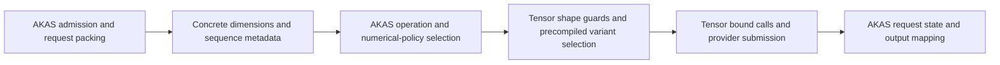

# Dynamic shapes and optional batch invariance for AKAS

Planning baseline: **2026-10-18**. Status: proposed design and implementation
sequence; the interfaces below are illustrative, not shipped APIs.

Inspected revisions: Tensor `274d429ed9945b45ea5b8e492248355e1611a047` and
AKAS `5259580d29f1d0182f1346f43cd8ced15913a4e2`. This plan covers work in both
repositories. It changes no runtime behavior by itself.

## Recommendation

Compile performance-oriented dynamic kernels over explicitly bounded shape
domains, then adopt that execution contract in AKAS. Shape ranges are inputs to
optimization and schedule search as well as runtime validation. A producer build
selects a bounded portfolio of optimized kernels covering the admitted domain;
each kernel retains runtime extents within its region. Inference selects and
launches those kernels at the actual shape without compiling code.

The objective is competitive execution across the declared workload range, using
ahead-of-time knowledge where a JIT would specialize after observing a shape.
Region partitioning, compiler assumptions, schedule tuning and performance gates
belong in the initial implementation. A single kernel for a broad range is useful
when measurements support it; multiple regions are appropriate when schedules
need to change. Exact-shape specializations can be additional portfolio members.

Compilation latency is also user-facing performance. The
[compilation latency and benchmark turnaround plan](compilation-latency.md)
defines stage attribution, cold/warm/incremental reuse, preparation budgets and
command-to-first-sample reporting. Region portfolios and multi-shape validation
must satisfy those producer-time and memory budgets alongside execution goals.

The [compiler literature review](../studies/compiler-design/reports/literature-review.md)
adds a shared shape-generic candidate/search bank as an alternative to independent
per-region searches. Regions may be derived dispatch results over shared kernels.
Compare both under equal producer budgets before fixing the tuning architecture;
also measure reuse of ragged metadata across operators and layers.

Treat batch invariance as an independent numerical policy. Enabling it selects
qualified arithmetic paths and constrains schedule selection, fusion and graph
rewrites. Disabling it permits the existing performance-oriented choices.

Prioritize dynamic decode batches, then packed prefill. Dynamic rectangular
shapes remove geometry rounding but do not remove padding between requests of
different lengths. Packed execution is needed to address that remaining waste.

## Current implementation and gaps

| Area | Present behavior | Required extension |
|---|---|---|
| Tensor frontend | [Signature extraction](../../src/tensor/compiler/frontend/signature.py) serializes symbolic extents and integer expressions | Bounded shape contracts, relational guards and qualification across several dynamic axes |
| Tensor calls | [Shape binding](../../src/tensor/runtime/signature.py) infers direct symbols, checks expressions and resolves launch sizes; [Executable](../../src/tensor/runtime/executable.py) allocates resolved outputs | Validate declared domains before allocation/submission; expose supported reusable binding rather than depending on private methods |
| Tensor CUDA examples | [Dynamic affine](../../examples/dynamic_affine.py) and [dynamic GEMM](../../examples/dynamic_gemm.py) use runtime extents with static tiles | Dynamic batch/token combinations and realistic operation families |
| CUDA evidence | [Provider tests](../../tests/providers/test_cuda.py) cover five affine lengths and five GEMM row counts, including tile boundaries | Execute broader shapes on qualified targets; existing tests do not establish general dynamic inference support |
| Tensor storage | [BufferView](../../src/tensor/runtime/buffer.py) only reshapes equal-sized storage | Borrow contiguous logical prefixes from capacity allocations |
| Tensor replay | [CudaGraph](../../src/tensor/providers/cuda/graph.py) captures fixed launches and for arguments; WebGPU prepared plans also retain bindings | Explicit rebinding/replay policy for changing shapes |
| AKAS graph | `src/akas/graph.py` requires positive static integers; calls reference buffers | Serializable shape expressions and explicit scalar/dimension bindings |
| AKAS validation | `compilation/validate.py` checks exact shapes and rejects scalar bindings; `execution/plan.py` also requires exact shapes | Check symbolic storage contracts and bind resolved logical shapes/scalars |
| AKAS batching | `execution/batch.py` chooses the smallest compiled row count that fits, then writes rectangular zero-padded token inputs | Dispatch on actual live requests/tokens; retain old geometries as an explicit compatibility mode |
| AKAS allocation | `compilation/buffers.py` and `execution/workspace.py` reuse equal static shapes | Bounded capacity planning and logical views with preserved lifetimes |
| AKAS numerics | Projection partitions, attention splits, phase-specific algorithms and tuning are operation-owned | Numerical policy propagated through all selection and rewrite paths |

The earlier [symbolic-shape study](../studies/phase0/reports/e4b-symbolic-shapes.md)
already distinguishes dynamic global extents from static tile extents. This work
extends that foundation; arbitrary dynamic shared-memory/fragment tiles are not
the starting point.

AKAS source references above are relative to its repository root. Its
[compilation guide](https://github.com/kreasof-ai/akas/blob/5259580d29f1d0182f1346f43cd8ced15913a4e2/src/akas/compilation/README.md)
and [batch implementation](https://github.com/kreasof-ai/akas/blob/5259580d29f1d0182f1346f43cd8ced15913a4e2/src/akas/execution/batch.py)
record the inspected geometry contract.

## Ownership



Tensor owns expression validation, propagation of shape assumptions into
lowering, kernel signatures, artifact capabilities, call binding, buffer
descriptors and backend submission. Its discovery tools support region-aware
search, numerical qualification, domain-wide measurements and portfolio selection.

AKAS owns request packing, KV/recurrent state semantics, operation definitions,
graph rewrites, model-wide policy and end-to-end acceptance. Ragged metadata can
be ordinary Tensor buffers; Tensor does not need a model scheduler or KV manager.

## Shape and storage contracts

### Dynamic extents, static model structure

Keep weights, hidden/head dimensions, quantization block widths, instruction
shapes, shared-memory tiles, workgroup sizes and pipeline stages specialized.
Make live request count, live token count and appropriate sequence-loop bounds
runtime values. Decode typically has `T = B`; packed prefill has
`T = sum(lengths)`. Rectangular transitional kernels can use `T = B * S`.

Distinguish these values from capacities: `B_capacity` bounds requests in a step,
`T_capacity` bounds tokens in a step, and `max_context` bounds each request's
history. Persistent request slots are separate from execution rows. Reserving a
state/scratch pool does not require executing its unused rows.

Reuse the existing safe integer-expression representation. Initially support
constants, direct symbols and existing arithmetic operations; do not add a
general symbolic solver. For a flattened shape such as `[B * S, H]`, require
explicit `B` and `S` if they cannot be inferred from direct input axes. A product
does not uniquely determine its factors.

Add versioned metadata for symbol bounds, necessary divisibility constraints,
relations and supported layouts. Validate conflicting bindings, bounds,
overflow, byte sizes, alignment and device launch limits before allocation or
submission. Divisibility guards must reflect real kernel requirements: a live
token count need not be tile-aligned when masked tails are supported.

Start with positive extents, matching the current runtime. An empty scheduler
step submits no calls; individual empty requests are excluded from that step.
Support for zero-sized tensor buffers is a separate contract change.

### Shape domains as optimization inputs

Declare four separate pieces of producer information:

| Input | Purpose |
|---|---|
| Legal shape domain | Minimum/maximum extents, relationships and required alignment/divisibility; defines what must execute correctly |
| Optimization regions | Subdomains with schedules chosen for their hardware behavior; together cover the legal domain |
| Workload profile | Expected shapes, frequencies, sequence-length distributions and latency/throughput goals; guides measurements and ranking |
| Storage capacities | Allocation and admission limits; may exceed a kernel region's live extents |

For example, an AKAS program can admit `1 <= B <= 256`,
`B <= T <= 4096` and histories up to 32768 tokens, with decode constrained by
`T = B`. The dense projection's row dimension is `M = T`, so its prefill regions
must be selected by live tokens, rather than request count alone. Attention
regions may also depend on query/history lengths and their distribution across
requests. These are illustrative bounds, not measured optimal settings.

Propagate each region's bounds and supported modular/relational assumptions into
the relevant compiler analyses and lowering passes. Use them to simplify index
arithmetic, prove applicable bounds, choose vectorized/aligned paths, select
static tiles and pipeline settings, and reduce unnecessary conditionals where
valid. All assumptions need matching dispatch/runtime guards. A declared maximum
does not eliminate checks on the final partial tile or make every loop static;
preserve runtime loop limits and execute only the live work.

Split aligned interiors and irregular tails into guarded variants when that
improves measured cost, while covering both. For decode projections, candidate
regions such as `B = 1..8`, `9..32`, `33..128` and `129..256` can seed search;
the measured crossover points determine the final regions. These intervals are
search seeds, not fixed padding buckets: `B = 7` still executes seven live rows.
Static tiles may issue some masked instructions at their boundaries.

First verify which assumptions the pinned TileLang/TVM stack actually consumes.
[TVM's arithmetic analyzer](https://tvm.apache.org/docs/reference/api/python/arith.html)
provides range bindings and modular constraint scopes, which are possible
integration points. Their existence does not mean bounds added to Tensor's
manifest automatically reach code generation. Retain lowering/source inspection
and measurements showing the effect of each supported assumption. If a proposed
transformation is unavailable, record it explicitly and evaluate schedule/region
alternatives within the producer's budget.

AKAS supplies expected workload shapes and sequence statistics; Tensor provides
the generic domain, lowering and search mechanisms. Avoid a Cartesian product of
every batch, token and context value. Keep region count, build time and artifact
size bounded, splitting regions where a schedule change produces a measured gain.
Per-request device lengths need not become host-read scalars for dispatch:
use already-known host metadata, conservative regions, or bounded device-side
scheduling when its cost is justified.

### Packed sequences

Use contiguous token activations `[T, H]` and token IDs `[T]`, together with:

- `sequence_offsets[B + 1]`, beginning at zero and ending at `T`;
- `request_slots[B]` and `start_positions[B]` for persistent state addressing;
- per-request lengths, derived from offsets or supplied consistently;
- output-token indices for final-token heads and speculative verification;
- optional token-to-request metadata when it avoids repeated lookup work.

For lengths `[5, 17, 129]`, the distinction is:

| Execution representation | Token rows presented to dense token operations | Padding rows |
|---|---:|---:|
| Static geometry `[8, 256]` | 2048 | 1897 |
| Exact dynamic rectangle `[3, 129]` | 387 | 236 |
| Packed tokens | 151 | 0 |

This counts logical token rows, not issued hardware instructions. Packed kernels
still have masked tile tails and scheduling overhead. Attention must honor
sequence boundaries, causal positions and valid history, rather than treating
the packed tokens as one sequence. Existing masks already preserve semantics in
some paths; avoiding padded dense work requires changing their representation.

Host packing provides `B` and `T` without reading device state. Per-request
lengths and offsets remain device inputs inside attention/state kernels. Validate
host-built offsets for monotonicity, terminal offset, slot uniqueness and context
bounds. For later device-generated metadata, use a bounded device protocol;
do not introduce a host readback between every kernel.

Keep the current persistent-state representation initially. Dynamic execution
does not require a paged-KV redesign. Packed GDN, convolution and other recurrent
paths must reset/advance state by request and preserve token order.

### Capacity allocations and logical views

First prove shape correctness with concrete allocations and uncaptured calls.
Then reserve bounded activation/scratch storage and bind a contiguous prefix
with the actual logical shape at each step. Start at byte offset zero, preserving
the allocation's alignment; arbitrary strided slices are outside this phase.

The existing equal-size reshape view is insufficient. A new capacity-view
contract must validate `logical_bytes <= available_bytes`, nested view ranges,
ownership and base lifetime. CUDA descriptors, WebGPU opaque handles,
transfers and DLPack must all identify the same logical range. WebGPU currently
checks descriptor byte size against registered buffer size, so this requires
provider work, not just relaxing the Python reshape check.

Do not mutate descriptors retained by in-flight calls or captures. Retain views
until completion, and retire captures before reallocating their storage. Use
separate scratch arenas for concurrent work. Initially share a scratch slot only
when its symbolic layout/capacity is compatible and lifetimes cannot overlap;
broader allocation packing can follow.

Scratch remains explicit kernel buffers managed by AKAS. Tensor's current ABI
requires zero external executable workspace; dynamic execution alone does not
justify changing that ABI field's meaning.

## AOT optimization portfolios, tuning and replay

Produce a portfolio per semantic operation, dtype, layout, provider, target and
numerical mode. Every admitted shape maps to an optimized region. A build must
reject holes in its declared domain; start with region/guard forms whose coverage
can be checked directly. Overlapping candidates are resolved by a retained,
measured dispatch policy with explicit deterministic precedence. Outside the
declared domain, reject the call with its missing constraint; inference does not
import the compiler or silently broaden the optimization contract.

Use the following producer workflow as a working baseline. LIT-01 in the
literature review compares separate region searches with joint search and
measurement reuse; do not require a fresh search for every region or concrete
shape.

1. Declare the legal domain, workload profile, numerical policy and build/artifact
   budgets. Seed regions from changes in tile count, occupancy, alignment and
   algorithm family, including the existing accepted schedules.
2. Compile candidate dynamic schedules with the region assumptions. Each candidate
   keeps actual live extents as runtime parameters; compilation is not repeated
   for every integer shape in its region.
3. Qualify candidates at region boundaries, tile boundaries, irregular interiors
   and held-out shapes. Numerical qualification precedes positive timing records.
4. Measure representative points using the actual dynamic binary and actual
   shapes. Compare with matched exact-shape schedules and the existing padded
   execution path; measure dispatch and packing separately as well as end to end.
5. Select a portfolio and dispatch regions subject to per-region regression limits,
   weighted workload cost, serving latency goals and code/build-size budgets.
   Split or retune regions when their accepted schedule is uncompetitive.
6. Rebuild and recheck the selected portfolio in a fresh consumer. Retain its
   region map, compiler assumptions, measurements and unmeasured cells.

Performance is an acceptance criterion from the first dynamic decode milestone.
Choose explicit per-region budgets against a matched exact-shape reference and
the real AKAS serving baseline. A weighted average alone must not hide a severe
regression in a supported small-batch or long-context region. Compare numerical
modes against references with the same guarantees; record the additional cost of
enabling batch invariance separately. Finite measurements support the stated test
matrix; they do not prove a speed bound for every shape and input in the domain.

Include shape domains, assumptions, region/dispatch maps, numerical policy,
schedule and source/toolchain/target identities in artifact/profile identities.
Keep workload and measurement provenance with portfolio-selection records;
different selected portfolios must have distinct identities. Exclude each
concrete runtime extent from a dynamic image's build key. Existing single-shape
measurement/search hooks need a multi-shape trial and portfolio-selection layer.

Runtime replay is a separate problem from dynamic kernel code. Captured CUDA
graphs retain scalar arguments and grids: changing Python dimension values
after capture does not update them. WebGPU prepared plans likewise need deliberate
rebinding. Use this sequence:

1. Submit correctly rebound dynamic calls without capture.
2. Reuse capacity storage and public prepared-call bindings.
3. Measure whether capture materially improves the serving workload.
4. Add validated CUDA graph-node parameter updates, with safe fallback to ordinary
   dynamic submission when topology changes. A small bounded cache of common
   captures is an optional intermediate optimization.

An exact-shape capture cache must have a memory/entry bound; it is not the shape
coverage mechanism. Fixed-capacity grids with device control buffers can be
evaluated later, but they may reintroduce idle work. WebGPU needs its own prepared
submission implementation and measurements. Begin with CUDA, preserving current
WebGPU/CPU behavior until their new capabilities are qualified.

## Batch-invariant numerical policy

### Observable guarantee

With the policy enabled, the same request's outputs and updated state are bitwise
identical when unrelated batch members, batch size or row position change,
provided its input/history, weights, quantization, numerical contract and
qualified hardware/software environment are identical. This includes requests
moving between tile positions and precompiled dispatch branches.

Repeated execution of one shape is only a determinism test. Tolerance-based
correctness against a reference is also necessary, but does not establish batch
invariance. Numerical equality within a tolerance cannot replace byte comparison.

Record batch invariance and chunk/phase invariance as separate capabilities.
Batch-only qualification holds each request's token segmentation fixed.
Chunk/phase qualification additionally covers changing prefill boundaries,
prefix reuse, prefill versus decode and speculative verification paths for the
same logical history. AKAS can advertise scheduler-independent reproducibility
only when every enabled path has that stronger qualification. Recurrent scan
versus sequential update algorithms are a particular risk.

The initial guarantee is single-device inference, scoped to qualified target,
toolchain and numerical-contract versions. It makes no cross-provider,
cross-architecture, training/backward, or tensor-parallel equivalence promise.
Seeded sampling additionally needs request-local RNG accounting; first qualify
logits, persistent state and greedy outputs independently of sampling.

### Configuration and artifact selection

Propose `batch_invariant: bool` as the consumer-facing choice. Preserve existing
behavior with a default of `False` in existing APIs; reproducibility deployment
profiles explicitly set it to `True`. The default is a proposed compatibility
choice, not a requirement of the numerical design.

A build may include only its selected numerical mode, or explicitly bundle both
`fast` and `batch_invariant` variants. A runtime switch selects among variants
already present. Switching a single-mode bundle requires another producer build.
Bind policy per executable/program/session, rather than a mutable process-global
flag. Change a live session's mode only at a documented request-state boundary;
do not mix arithmetic policies within an active request and claim reproducibility.

For example, proposed AKAS producer configuration could express:

```json
{
  "shape_mode": "packed",
  "max_requests": 256,
  "max_step_tokens": 4096,
  "max_context": 32768,
  "shape_domain": {
    "B": {"min": 1, "max": 256},
    "T": {"min": 1, "max": 4096}
  },
  "optimization": {
    "partition": "auto",
    "max_variants_per_operation": 8
  },
  "numerical_modes": ["fast", "batch_invariant"]
}
```

The runtime would independently select `batch_invariant: true` or `false` when
opening that program. Here `max_requests` bounds the shared request-slot pool;
live `B` is also bounded by that pool, while `max_step_tokens` bounds one execution
step. The domain also carries `T >= B`, with `T = B` for decode; the runtime
relations use the versioned expression/guard representation described above.
The producer additionally takes a workload profile and performance/build budgets;
the illustrated automatic partition search has an eight-variant budget per
operation. The maxima alone do not specify those optimization choices. These names illustrate
the separation of build coverage from runtime choice; they do not replace today's
`geometries` configuration until migration is implemented.

When `True`, reject any requested operation, rewrite or phase without qualified
coverage. When `False`, both qualified invariant kernels and faster alternatives
remain eligible; it grants no bitwise guarantee. Report the effective mode,
variant and numerical-contract identity in inspection and benchmark output.

Tensor cannot make arbitrary user-authored TileLang kernels batch-invariant with
a generic compiler switch. The producer must supply an implementation with an
explicit numerical contract. Tensor can enforce supported compiler policies,
retain declarations and qualification evidence, and reject incompatible choices;
AKAS must supply and qualify its operation families. Distinguish an author
declaration from measured qualification, tied to the exact executable hash and
test domain. Finite tests are acceptance evidence, not a proof over all inputs.

### Operation rules

| Operation/path | Invariant-mode rule |
|---|---|
| GEMM/GEMV and quantized projections | Fix each output's reduction/instruction structure, accumulator precision and rounding across batch shapes. Start with one no-split-K arithmetic path. A GEMV/GEMM switch needs explicit bitwise equivalence evidence. |
| Normalization and softmax | Keep row-local reductions and their tree fixed; batch size cannot select a different reduction strategy. |
| Attention | Preserve absolute key order, tile boundaries and merge order. Start with one canonical path; later fixed absolute KV partitions with a canonical merge can improve parallelism. Batch-dependent balanced splits are ineligible. |
| Activation/KV quantization | Use request/token-local groups along fixed feature blocks, stable rounding and the same cache encode/decode path. Batch-wide scales would couple unrelated tokens. |
| MoE | Stabilize routing ties using semantic indices; preserve expert contributions and merge order per token. Batch capacity must not change token dropping or arithmetic. |
| Fusions and rewrites | Preserve casts, intermediate rounding, approximation choices and accumulation. Reject or separately qualify fusions that alter these. |
| GDN, convolution and recurrent state | Preserve request boundaries and state-update order. Different chunked/parallel scan algorithms need separate chunk/phase equivalence qualification. |
| Argmax/top-k and output mapping | Define stable tie rules using token/expert identity rather than batch-row position. |

Merely fixing the number of attention splits, removing atomics, or selecting
`partitions=1` does not prove the whole program invariant. Likewise, split
reductions are not universally forbidden: a canonical partition/merge can qualify
if it preserves the declared arithmetic across the entire supported domain.

In invariant mode, tune within a numerical equivalence family. Initially freeze
arithmetic-affecting parameters and compare every candidate and dispatched
specialization to a canonical kernel. Expand scheduling freedom only with
target-bound qualification. GPU-free compiler checks must reject known-invalid
choices but cannot label an unexecuted kernel as measured bitwise equivalent.
Region boundaries do not reset this requirement: kernels selected for different
batch/token ranges must preserve the same per-request arithmetic contract.
Optimize scheduling and data movement within that contract, then separately
qualify additional arithmetic implementations before adding them to the portfolio.
Record math approximation, contraction/reassociation and denormal handling in
the numerical contract alongside instruction layouts and accumulator precision.
Enable optimizations only when they preserve that contract; batch invariance does
not inherently require disabling every fast-math optimization.

### Relevant precedents

[DeepSeek-V4, section 3.3](https://arxiv.org/html/2606.19348v1#S3.SS3) describes
batch-invariant arithmetic across its kernel stack. It replaces cuBLAS with
DeepGEMM, largely avoids split-K, and describes two attention kernels whose
accumulation paths agree despite different parallelism. This supports a
qualified multi-variant design; its hardware-specific performance claims do not
establish performance for Tensor's targets. Tensor's current CUDA frontend also
rejects cluster/cooperative launches, so the distributed-shared-memory attention
optimization is a later capability project.

[Thinking Machines' analysis](https://thinkingmachines.ai/blog/defeating-nondeterminism-in-llm-inference/)
identifies reduction-order changes as a source of batch dependence, including
attention partition boundaries under chunked execution. Its fixed-size KV
partition approach is a useful starting point for the stronger chunk contract.

The [vLLM consistency implementation report](https://vllm-project.github.io/2026/10/14/train-inference-consistency.html)
also illustrates why GEMM selection, quantization, routing and cache read paths
need coordinated qualification. These are references for design choices, not
dependencies to add to Tensor's consumer runtime.

## Staged implementation and acceptance

| Stage | Tensor work | AKAS work | Exit gate |
|---|---|---|---|
| 0 — Freeze contracts | Shape-domain/region schema, numerical scopes, compatibility rules, public binding and multi-shape tuning design | Enumerate operation/phase coverage for one model; record workload distribution, exact/padded baselines and performance budgets | Reviewed binding fixtures, a complete pilot inventory, and explicit region/build/performance budgets |
| 1 — Dynamic calls and region compilation | Multi-axis examples; guarded range assumptions; public bind/rebind API; multi-shape trials and initial region portfolios | Symbolic graph/scalar references, symbolic candidate validation, resolved uncaptured plans | Immutable region binaries reused at previously uncompiled shapes; full domain coverage and retained optimization/timing evidence |
| 2 — Optimized dynamic decode | Capacity prefix views, provider lifetime validation and measured region dispatch | Live `B`, shared state pool, request-row remapping and bounded scratch | Batches such as 1, 3, 7, 31, 33 plus maximum run correctly; each tested region meets its agreed performance budget |
| 3 — Optimized packed prefill | Qualify/tune dynamic token loops and region-aware attention schedules | Offsets, packed token ops, attention/state boundaries, final-token outputs and compiler rewrites | Mixed lengths execute `sum(lengths)` logical token rows correctly and pass workload/region performance gates |
| 4 — Invariant kernels and program | Policy metadata, qualification/report hooks, cache/profile separation | Canonical linear/norm/attention/quantization paths, policy-aware rewrites, then recurrent/MoE families as needed | Exact per-request outputs and state match across batches/positions; unsupported scopes fail explicitly |
| 5 — Serving optimization and release | Refine portfolios, prepared submission/capture improvements, backend expansion | Serving integration, workload-weighted refinement and deployment records | End-to-end performance budgets pass; both numerical modes, bounded artifact costs and compatibility behavior demonstrated |

Stage 4's kernel work can start after stage 0 and proceed alongside dynamic
execution work. Full program qualification depends on stages 2 and 3. Do not
block useful dynamic-shape delivery on complete batch invariance or graph updates.

Use a small graph for contract tests, then one real AKAS model with its complete
operator inventory. A dense attention model narrows the first numerical scope;
LFM2 and Qwen35/GDN must separately qualify their recurrent paths before receiving
the same model-level label. MoE and speculative phases are additional coverage,
not automatically inherited from a dense decode demonstration.

### Validation ownership and memory budgets

Reference mathematics, input distributions, storage/quantization semantics and
tolerances belong to AKAS's operation/workload definitions. Tensor's generic
trial infrastructure owns bounded resource orchestration, cleanup and measurement
hooks for the resources it creates. AKAS's qualification runner has the same
responsibility for its cases and caches. Compiler/provider resources that grow
without bound under repeated equivalent trials are implementation defects;
workload size is not a reason to accept leaked resources.

OOM alone does not establish a leak. A single reference may exceed available RAM
because of dense dequantization, FP64 promotion, copied input/state arrays and
comparison temporaries. Retaining several case signatures multiplies that live
working set. Distinguish this from objects that remain reachable accidentally,
native allocation leaks and allocator memory retained for reuse. The inspected
AKAS runner caches host cases and device buffers until each operation search ends;
some linear references copy every argument and materialize FP64 weights. Tensor's
current `tune()` also downloads outputs and constructs full-sized error arrays.
These are concrete pressure points, not a reproduced leak diagnosis.

Plan validation as a separately budgeted producer stage:

- Estimate host inputs, expected state/output, decoded weights, oracle scratch,
  comparison temporaries and device memory before a case runs. Bound active
  cases, retained cache bytes and concurrent compiler/validation workers.
- Reuse compatible reference results across schedule trials with identities that
  include semantics, shape, input seed/data, quantization and numerical contract.
  Use byte-limited eviction and release all owned buffers on success, rejection
  and exceptions; `gc.collect()` is not a resource-budget policy.
- Tile/stream independent references and comparisons, sharing immutable data
  where safe. Preserve required reference precision and reduction semantics.
  Avoid decoding full maximum-capacity state when only a live range is needed.
- Keep independent NumPy/reference checks on tractable semantic and boundary
  cases. Full-scale trials can use a separately qualified device reference with
  bounded comparison storage. Record its independent qualification and common
  compiler risks; agreement with the candidate alone cannot establish correctness.
  Small-shape checks do not replace large-shape memory/state validation.
- Retain exact per-request output/state comparisons for batch-invariant mode;
  checksums or sampled outputs do not replace that guarantee. Device comparison
  can return compact diagnostics while scanning the full relevant data.
- Record generation, reference, compile, transfer, comparison and kernel timing
  separately. Trace live NumPy allocations, process RSS/private memory, provider
  allocations and retained compiler objects. Repeated fixed-shape trials should
  reach a bounded steady state after warm-up. Use isolated workers when needed
  for native-resource lifetime control, while still bounding each case's peak.

[NumPy's memory documentation](https://numpy.org/doc/stable/reference/c-api/data_memory.html)
describes allocation tracing and internal reuse. Diagnose both peak working set
and retained memory rather than inferring a NumPy leak from process memory alone.
Add host/device memory and validation-time budgets to stage 0, and enforce them
from the first multi-shape trial. A wider shape domain must not cause all shape
references and decoded states to remain resident simultaneously.

### Required validation

- **Shape domains:** minimum/maximum, randomized interior values, `tile - 1`,
  `tile`, `tile + 1`, irregular products, conflicting symbols, unresolved factors,
  malformed expressions, overflow and out-of-domain launches. Exact-size and
  capacity-backed calls must agree.
- **Region optimization:** complete dispatch coverage, deterministic overlaps,
  guarded assumptions, crossover points and held-out shapes. Confirm actual live
  grids/loop bounds and inspect intended lowering differences. Reject results
  measured only at a region's upper bound or using an exact-shape binary in place
  of the selected dynamic binary.
- **Packed semantics:** mixed lengths `[5, 17, 129]`, mixed context positions,
  request permutation, admission/release/slot reuse, chunk tails and state isolation.
  Compare with independent model references under the existing correctness policy.
- **Memory safety:** poison unused capacity and adjacent state slots; verify they
  neither affect valid outputs nor receive writes. Exercise view release, base
  release, in-flight lifetimes, scratch reuse and both supported provider handles.
- **Batch invariance:** hold one request's semantic inputs fixed while changing
  unrelated requests, row positions and batch/tile sizes. Compare output and state
  bytes, including quantized storage and signed-zero behavior. Use a documented
  nonfinite-input policy; tolerance tests remain separate.
- **Stronger numerical scope:** when advertised, compare alternative chunk sizes,
  prefill/decode boundaries, prefix reuse and accepted speculative prefixes against
  the canonical history. Inspect intermediate layer outputs to localize divergence.
- **Artifact and replay behavior:** fresh compiler-free consumers, unchanged image
  hashes across runtime shapes, mode selection, missing variants, old artifacts,
  unsupported metadata, replay after dimension changes and bounded capture caches.
- **Performance:** compare matched exact-shape schedules, the padded AKAS baseline,
  and optimized dynamic rectangular/packed paths with invariance on/off. Report
  per-region and workload-weighted results, useful/padded token rows, artifact count
  and bytes, build/load time, peak/reserved memory, packing/upload/dispatch cost,
  prefill/decode latency, TTFT, inter-token latency, throughput and serving tail
  latency. Separate uncaptured and replay measurements. Apply the agreed budgets
  at each dynamic execution milestone; do not assume packing always wins.

Keep correctness and timing evidence tied to exact model, source, artifact,
toolchain and hardware identities. Choose regression budgets from the stage-0
baseline; this design supplies no unmeasured throughput or overhead promise.

## Compatibility and first deliverable

Retain existing static artifact semantics. Legacy artifacts have no new numerical
guarantee and remain usable in their existing mode. Use a versioned artifact
schema or required capability so an old consumer cannot ignore mandatory shape
guards or numerical requirements. Assess ABI changes from actual descriptor
needs; existing scalar arguments and resolved grids already handle much of this.
Add negative compatibility fixtures before emitting new required metadata.

AKAS symbolic graph/call metadata requires a new accepted bundle schema and an
explicit loader path. Do not reinterpret `akas.forward.v1` static shapes or
silently bypass its fingerprint checks. Upgrade its pinned Tensor revision only
after the corresponding runtime/compiler contracts are available.

The first implementation slice should be **stages 0–2 for CUDA dynamic decode**:
bounded live batch dimensions, assumption-aware region compilation and tuning,
reusable calls/capacity storage, request-state correctness and measured performance
acceptance. Design packed metadata and numerical-policy propagation in stage 0
so this slice does not harden another static geometry interface. Follow with
optimized packed prefill, then certify and further optimize the optional invariant
path. Performance work begins with the first compiled regions and continues
through serving acceptance.
